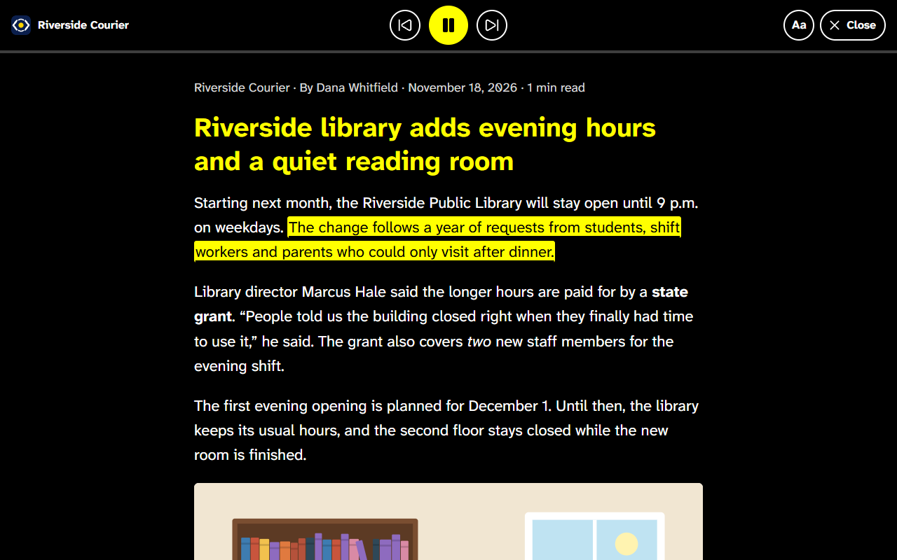

# VisioFix

A Chrome extension for people who use screen readers or have low vision. It:

1. **Repairs** common accessibility problems on the pages you visit, so screen readers work better:
   unnamed links and buttons, form fields not connected to their label, captioned photos with no
   description, invisible tracking images.
2. Opens **Focus Mode**: a clean reading view of the page's main content, in High contrast, Dark or
   Light, with the Atkinson Hyperlegible Next font.
3. **Reads aloud** in Focus Mode, highlighting each sentence as it's read.

Edge installs it from the Chrome Web Store too.

> Status: version 1.0.0, ready for Chrome Web Store review. Not yet published.



## Not an "accessibility overlay"
Site-injected overlays (scripts a site owner adds for every visitor) have a bad reputation with
screen reader users because they often break pages. VisioFix is different: **you** install it,
and it follows strict do-no-harm rules:

- It never deletes page content.
- It only adds what's missing, and never overrides what the page's author wrote.
- Every change is tagged and reversible: turning VisioFix off for a site restores the original page.
- What it can't fix without guessing (icon-only buttons, pictures with no caption), it reports
  instead of making something up.
- It never speaks on its own; read-aloud only starts when you press play.

## Privacy
Nothing leaves your computer: no analytics, no data collection, no remote code. Settings are saved
in this browser only. Read-aloud uses the voices installed on your computer; online voices (which
send the text to Google or Microsoft) are off unless you turn them on. Full policy:
[PRIVACY.md](PRIVACY.md).

## Keyboard shortcuts
| Keys | Action |
|---|---|
| Alt+Shift+F | Open or close Focus Mode |
| Alt+Shift+K | Read aloud: play or pause |
| Alt+Shift+. / Alt+Shift+, | Read aloud: next / previous sentence |
| Escape | Close Focus Mode |

On a Mac, Control+Shift instead of Alt+Shift. Change them at `chrome://extensions/shortcuts`.

## Install from source
Requires Node.js 22 or newer (developed on Node 26 LTS).

```bash
npm install
npm run build
```

Then open `chrome://extensions` (or `edge://extensions`), turn on **Developer mode**, click
**Load unpacked**, and choose the `.output/chrome-mv3` folder.

## Development
```bash
npm run dev           # dev build with auto-reload (opens Chrome)
npm test              # unit tests
npm run typecheck     # TypeScript check
npm run build         # production build in .output/chrome-mv3/
npm run zip           # store package: .output/visiofix-<version>-chrome.zip
npm run design        # design preview with sample data at http://localhost:5180
npm run fixtures      # test pages with known accessibility bugs at http://localhost:5181
npm run store-images  # store screenshots and promo tile, from the real build (run build first)
```

## Publishing
Everything the Chrome Web Store asks for is in [`store/`](store/): the listing text
([listing.md](store/listing.md)), the privacy-tab answers and permission justifications
([permissions.md](store/permissions.md)), screenshots, the promo tile, and the final manual test
checklist ([test-checklist.md](store/test-checklist.md)).

## Credits
- Font: [Atkinson Hyperlegible Next](https://www.brailleinstitute.org/freefont/) by the Braille
  Institute (SIL Open Font License)
- Icons: [Lucide](https://lucide.dev) (ISC License)
- Focus Mode: [Mozilla Readability](https://github.com/mozilla/readability) (Apache License 2.0)
- Repairs: [dom-accessibility-api](https://github.com/eps1lon/dom-accessibility-api) (MIT License)

License texts ship with the extension in `public/licenses/`.

The original Android app's code is kept for reference in `legacy/` and is not part of the build.
